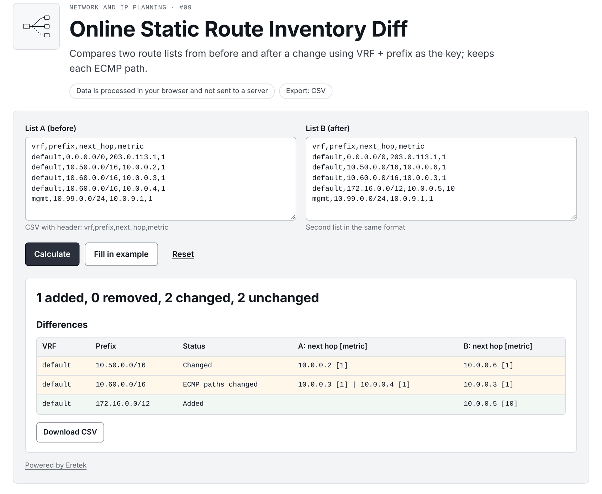

# Static Route Inventory Diff

Compare two static route CSVs by VRF and prefix: added, removed and changed next hop or metric; ECMP paths are kept separately.

## Try it live

- [Türkçe](https://network.eretek.com/araclar/statik-route-karsilastirici)
- [English](https://network.eretek.com/en/tools/static-route-diff)
- [Deutsch](https://network.eretek.com/de/werkzeuge/statische-routen-vergleich)



## What it does

Compares two route lists from before and after a change using VRF + prefix as the key; keeps each ECMP path.

Comparing route lists taken before and after a router or firewall change line by line is misleading because of ordering and ECMP: the same two next hops in a different order look 'changed'. The tool compares the next-hop set per VRF + prefix, ignores order and separates new, removed and changed routes.

## Where it helps

After capturing list B in the change window, review unexpected 'removed' or 'changed' rows against your rollback plan.

If interface names are used as next hops (e.g. `Null0`), write them the same way in both lists; comparison is case-insensitive.

## How to use it

1. Paste both lists as CSV with a header row. Required columns: `prefix` and `next_hop`; optional `vrf` and `metric`. Comma, semicolon or tab separators work.
2. Common column names such as `network`, `destination`, `gateway`, `nexthop` are recognised.
3. Press Calculate and download the differences as CSV.

### Fields

| Field | Description |
|---|---|
| List A (before) | CSV with header: vrf,prefix,next_hop,metric |
| List B (after) | Second list in the same format |

## Example input

Press **Fill in example** in the tool to load this input.

**List A (before)**

```text
vrf,prefix,next_hop,metric
default,0.0.0.0/0,203.0.113.1,1
default,10.50.0.0/16,10.0.0.2,1
default,10.60.0.0/16,10.0.0.3,1
default,10.60.0.0/16,10.0.0.4,1
mgmt,10.99.0.0/24,10.0.9.1,1
```

**List B (after)**

```text
vrf,prefix,next_hop,metric
default,0.0.0.0/0,203.0.113.1,1
default,10.50.0.0/16,10.0.0.6,1
default,10.60.0.0/16,10.0.0.3,1
default,172.16.0.0/12,10.0.0.5,10
mgmt,10.99.0.0/24,10.0.9.1,1
```

**Expected result:** 1 changed (10.50.0.0/16 next hop 10.0.0.2 → 10.0.0.6), 1 ECMP change (10.0.0.4 removed from 10.60.0.0/16), 1 added (172.16.0.0/12), 2 unchanged.

## Method and assumptions

Each prefix is reduced to its network address; the key is `VRF | prefix` ('default' if no VRF). The value of a key is the set of `next_hop [metric]` pairs, so each ECMP path is kept and order does not matter.

Keys only in A are removed, only in B are added, and different sets are changed. Changes involving more than one path are flagged as 'ECMP change'.

## Limits and common mistakes

- Administrative distance, tags and tracking are not compared.
- It does not distinguish routes learned from dynamic protocols; it compares the lists you enter.
- Up to 20,000 lines.

## Run it locally

The tool is plain HTML, CSS and JavaScript with no build step and no dependencies.

```bash
git clone https://github.com/eretek/static-route-diff.git
cd static-route-diff
node scripts/serve.js        # or: python3 -m http.server 8080
```

Open <http://127.0.0.1:8080/>. Add `?lang=tr` or `?lang=de` for Turkish or German; without it the page follows the browser language and falls back to English. You can also open `index.html` directly from disk.

Run the tests (Node.js 18 or later):

```bash
node test/run.js    # or: npm test
```

The tests run the tool's own fixtures and the worked examples in all three languages without a browser.

## How it works

All processing happens in your browser. The tool makes no network requests, uses no cookies or browser storage, and does not upload files you select.

No server-side component is needed. The version on the Eretek website renders the same page through a private WordPress plugin; that plugin only produces the page markup and is not part of this repository.

| Path | Purpose |
|---|---|
| `index.html` | Page shell |
| `src/app.js` | Builds the page in Turkish, English or German from `src/data.js` |
| `src/data.js` | Field definitions, examples and all texts in three languages |
| `src/core.js` | Shared runtime: validation, number formats, result rendering, CSV/ICS export |
| `src/tool.js` | The calculation or analysis for this tool |
| `docs/screenshot.png` | Screenshot used in this README |
| `src/lib/ip.js` | IPv4/IPv6 library (BigInt) |
| `src/tools.css`, `src/page.css` | Styles |
| `test/run.js`, `test/cases.json` | Headless tests |

## License and attribution

This tool is released under the [Eretek Website Attribution License](LICENSE). You may use, modify and redistribute it, including commercially. If you make it available on a website or web application, show a visible, clickable credit linking to https://eretek.com/ on every page where the tool is available, for example:

```html
<a href="https://eretek.com/">Powered by Eretek</a>
```

You may add `rel="nofollow"` to the link. Keep the copyright notice and license text in copies and redistributions.
